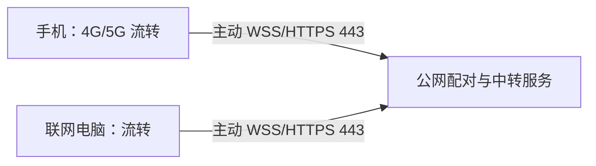

# 手机移动数据远程同步：实现方案

日期：2026-10-14。状态：设计提案，未实施。依据当前源码与官方网络文档；用户已要求停止后续测试，本次仅阅读代码、查阅资料与整理文档，不构建、不继续操作手机、不部署服务。

## 目标与推荐路线

手机在外使用 4G/5G，电脑在家或办公室联网，双方不在同一局域网也能同步文字和素材。电脑必须开机、流转运行且网络可用。手机热点与电脑之间的本地传输继续使用局域网模式。

建议分两阶段：先支持成熟的远程组网，满足个人跨网同步；再按是否需要完全内置、是否能提供中转服务器，实施内置远程连接。两个阶段共用连接端点、设备身份和流量策略，避免以后重写收发页面。

| 路线 | 连接方式 | 用户准备 | 适合情况 |
|---|---|---|---|
| A：远程组网，优先建议 | 两端加入同一 Tailscale 私有网络，流转连接电脑组网地址 | 两端安装并登录组网客户端；配置访问权限 | 较快获得个人跨网同步，无需先维护自建中转服务 |
| B：流转内置中转 | 两端主动连接公网 WSS/HTTPS 443 服务 | 公网服务器、域名、证书与运维资源 | 希望只打开流转，或手机已有其他 VPN 不能同时运行组网客户端 |

Tailscale 优先尝试直接连接，无法直连时可走中继；官方说明这些通道均使用 WireGuard 加密。中继性能与网络条件有关，不能预先保证大文件速度。[连接方式](https://tailscale.com/docs/reference/connection-types)、[连接机制](https://tailscale.com/docs/reference/device-connectivity)。

Android 每个用户/工作资料同时只有一个活动 VPN 服务；因此组网路线与另一款使用 VPN 服务的应用可能冲突。分应用规则不能消除这个系统限制。[Android VPN](https://developer.android.com/develop/connectivity/vpn)、[Tailscale 与其他 VPN](https://tailscale.com/docs/reference/faq/other-vpns)。

## 当前代码的真实阻碍

1. `AndroidApp/app/src/main/java/com/liuzhuan/app/LanController.kt` 只接受 Wi-Fi、以太网、VPN 和本机 Wi-Fi 热点，纯 CELLULAR 不会使局域网连接恢复。不能简单全局放开，否则离开 Wi-Fi 后会持续重试不可达的私网地址。
2. `Liuzhuan/Utils/LanNetUtil.cs` 为避免选到虚拟网卡，刻意排除 Tailscale、WireGuard、VPN 等名称；`QrCodeWindow.xaml.cs` 使用此列表。安装组网工具后，原二维码仍不提供远程组网地址。
3. `Liuzhuan/Services/Lan/WsHub.cs` 的 `HandleGetItem` 使用 `GetLanIp()` 生成绝对下载 URL。即使远程 WebSocket 成功，下载也可能跳到不可达的物理局域网 IP。
4. Android 的 `LanClient.kt` 和 `MainActivity.kt` 分别拼接 `ws://host:port`、`http://host:port+1`，上传与缩略图入口也如此。必须一起改，不能只修 WebSocket。
5. 现有连接使用局域网 WS/HTTP，口令哈希放在请求参数中；`AuthService.cs` 只检查哈希和时间偏差，不提供完整设备信任与一次性挑战。时间窗口不是完整的重放防护。这个协议不应直接开放到公开公网。
6. M38 历史连接以 host + port 区分，尚无模式、scheme 或稳定电脑身份。远程记录需要迁移扩展。
7. 当前暂停后继续为重新发送整个文件，尚无字节级断点续传。远程大文件容易浪费流量，必须明确展示这一边界。

## 共用改造：连接端点与流量策略

新增统一的 `ConnectionEndpoint`，包含模式、WebSocket 基址、文件基址、设备身份与协议能力。所有上传、下载、缩略图和重连都从同一个已配对端点取地址；通过 URI 构造处理端口、域名和 IPv6，不在页面内重复字符串拼接。

模式分为 `LAN`、`OVERLAY`、`RELAY`：

- LAN 保留现在的热点/Wi-Fi 判断、离线停止盲重试和旧二维码。
- OVERLAY 使用用户明确选择的组网地址。不能因为任意 VPN 存在就宣称对端可达；实际 socket 失败仍走有上限退避。不能仅凭某个 IP 段自动认为连接可信。
- RELAY 使用已配对的 HTTPS/WSS 服务，仅在用户启用远程模式后允许蜂窝网络，网络切换触发一次恢复而非重建多个并行连接。

扩展欢迎消息的能力协商：新协议发送相对文件路径或素材 ID，由手机基于当前会话的可信文件端点生成 URL；不随意信任服务器给出的其他 host。旧版本仅在 LAN 模式保留既有绝对 URL。`Proto.kt`、`LanMessage.cs`、`WsHub.cs` 必须成对修改，远程功能没有协商成功时明确提示版本不支持。

历史配置加入模式与两个基址；旧记录迁移为 LAN，继续保留加密凭据和其他偏好。将“局域网 / 远程组网 / 内置远程”显示在历史列表中，避免对着旧局域网地址用移动流量重连。

流量默认值建议：

- 远程连接首次独立确认是否自动同步剪贴板；沿用原隐私排除与暂停规则。
- 同步素材目录和允许的文字；原文件仅在用户点击后传输。
- 移动网络默认不自动加载缩略图；允许单独打开，使用有界缓存。
- 原文件超过 20 MiB 先确认，可修改阈值；后台自动发送图片/文件在移动网络默认关闭。
- 显示本次上传/下载量、连接模式、因流量策略暂停的原因；VPN 场景需考虑底层网络计费状态，判断不明时按计费网络处理。
- 网络或模式变化时暂停正在进行的大文件，获得确认后再走新路径。没有断点能力时显示“重新传输”，不能显示“继续剩余部分”。

保活按实际网络调整：蜂窝连接不获取无意义的 Wi-Fi 锁；保留进程级发送作用域、前台服务条件与 Hook 链路。远程默认优先现有均衡省电模式，心跳/退避按协议有界执行，不恢复剪贴板轮询，也不承诺所有 ROM 后台永不掉线。

## 阶段 A：远程组网

1. PC 设置增加“远程组网”独立入口，明确显示对应适配器与地址，支持手动填写组网域名；保留 LAN 地址筛选，避免重新把虚拟网卡选进普通二维码。
2. 生成有版本与模式字段的远程二维码。旧二维码仍只表示 LAN；新远程二维码必须让旧 Android 端明确无法使用，不能混用旧口令/地址字段造成错误降级。
3. 两端落实共用端点改造，尤其让下载使用本次扫码所选组网端点，而不是 `GetLanIp()`。
4. 由组网访问策略限制只有已授权手机能访问电脑流转的控制与文件端口；继续应用原流转鉴权。此阶段现有 WS/HTTP 仅运行在受保护的私有组网通道内。
5. Android 连接页提供客户端准备说明、历史连接与当前网络提示。UDP“搜索电脑”仍是局域网功能；远程通过扫码/历史连接，不把跨网广播发现作为前提。

这一阶段不要求先创建自建公网中转服务，但依赖组网服务和两端客户端可用。部署地域、实际运营商能否直连及性能【待确认】，后续只有用户要求恢复测试时才验收。

## 阶段 B：流转内置远程

电脑和手机都主动连出，不要求家庭路由器端口映射，也不要求电脑有固定公网 IP。第一版先用中转保证连接路径，之后才评估直连穿透；不能把所有运营商环境直连作为交付前提。

建议服务职责：

- 配对：电脑稳定随机设备 ID、一次性短时配对邀请、双方确认；设备密钥保存在本机安全存储，支持撤销。
- 会话：短期会话凭据、过期与刷新、限流、单设备连接替换与有界离线队列；认证信息不放 URL 查询参数。
- 中转：按设备/会话路由加密消息与分段文件，配置容量、流量限额、超时清理，不保存明文素材与口令。
- 加密：TLS 保护客户端到服务端的通道；另用成熟协议/库建立设备间端到端加密，覆盖剪贴板、素材目录与文件。仅做 TLS 中转不能称为端到端加密。具体跨 Kotlin/.NET 的库、许可和集成成本仍需选型，不自行发明密码协议。
- 文件：可协商的分块大小、上传会话 ID、已确认偏移/块位图、取消/过期、完整 SHA-256；两端校验通过后才登记素材。源文件变化时作废旧续传会话，接收端完成前保存临时文件。

MVP 按“配对与加密会话 → 文本/目录 → 手动分段文件 → 流量策略和后台恢复”实施。电脑离线时明确显示等待电脑上线，不默认把素材永久存入云端。任何后续云存储都需要单独产品决定。

该路线需要服务器、域名、部署地区与可接受流量预算；当前没有创建服务、购买资源或上传用户素材。程序实现前先确定这些资源，避免做出没有可用连接端点的按钮。

## 交付边界

本次只完成设计；M38 Android v1.8.6 已交付的历史连接不包含远程模式。没有改变现有两端协议、网络、防火墙或当前手机连接。

后续实施阶段仍需备份、两端成对修改与构建；用户当前的“不用测试”指令保持有效，本次不执行上列网络验收。要发布时需更新双语说明，清除设备地址、配对凭据和原始日志，并遵守届时的 GitHub/Release 授权。
