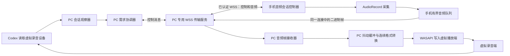

# 流转手机麦克风与 Codex 原听写：独立开发详细设计

设计日期：2026-10-16。本文是总体设计，替代此前“MicYou 插件适配”为实施方向的建议。以下模块名、协议字段与数值属于总体规格；首版已实现范围以随后的状态说明与实现记录为准。

后续状态：用户已授权“开始开发，先不做加密”。M39先实现局域网明文的手动链路与只读会话观察；本文以下TLS/长期信任、自动跟随和进一步按需采集仍为后续设计，不代表首版实现。当前源码与验证范围以[实现记录](../performance/PHONE_MIC_M39_2026-10-16.md)、ARCHITECTURE和DECISIONS D39为准。

## 1. 产品目标与实现原则

用户没有电脑实体麦克风，希望手机流转在局域网内供音；电脑流转观察 Codex 对虚拟麦克风的使用，自动请求音频，最后仍由 Codex 原听写生成编辑器文字。

首版边界：Windows 10/11 x64、现有 Android 16+、普通 Wi-Fi 或手机热点、一台选定电脑与一台选定手机、一对明确选定的虚拟音频端点。麦克风默认关闭，手机必须主动开启有效会话。支持手动控制，并将可靠的 Codex 会话识别作为自动模式的独立门槛。

独立实现原则：

- MicYou、AndroidMic、VoxMic 只用于理解优秀设计和失败边界，不复制或机械改名其业务源码、协议、项目结构、UI 资源或安装包，不创建竞品 fork 作为流转客户端。
- 形成“参考观察 → 本项目需求 → 自有接口/状态机 → 自有实现 → 行为验收”的记录，不宣称读过源码后完成了法律意义的隔离开发。
- 平台 AudioRecord、WASAPI、TLS 采用官方能力；通用库通过明确接口作为可替换依赖选型，不把其默认行为当作本项目规格。NAudio 2.x 是候选，不是必须复制的实现。
- 不做自有 ASR/润色，不改 Codex 程序，不通过坐标、鼠标 Hook 或注入 Codex 获得按钮事件。Codex 的识别结果和计费/数据处理沿其原功能。
- 首版继续使用成熟虚拟线缆驱动；自研 Windows 驱动作为另一个项目，不混入本次范围。

## 2. 用户操作与界面

### 2.1 首次设置

1. PC“设置 → 手机麦克风”展示功能说明、虚拟线缆是否安装、当前端点、音频服务端口。默认不改系统默认麦克风，也不打开手机录音。
2. 用户选择虚拟播放端和对应录音端。显示“流转写入”和“Codex 读取”的方向，保存稳定端点 ID；同名设备不能替代确认。
3. PC 生成独立“配对手机麦克风”二维码。原素材连接二维码保留；手机扫描新码后确认电脑身份、建立音频信任，PC 确认新手机。
4. 手机展示电脑名称和实际连接状态，点击“开启麦克风会话”后请求录音权限，选择会话时限。前台启动合法 microphone 服务并实际开始采集。
5. 手机明确显示“正在采音，暂未转发”；PC 显示“手机已准备，等待录音应用”。没有证据时不得提前显示就绪。
6. 用户在 Codex 或 Windows 中选择虚拟录音设备，先完成手动模式验收；后续才开放“跟随 Codex 使用状态”。

### 2.2 日常自动使用

手机已开启会话 → Codex 开始使用选定录音端点 → 流转验证进程/会话 → 发送转发请求 → 手机确认当前代次已转发 → PC 接收音频并写入虚拟播放端 → Codex 按原功能听写。

Codex 不再使用端点 → 短宽限后停止转发并清缓冲。手机仍采音时必须继续显示“采音待命”；“结束麦克风会话”才表示释放采集器。首版空闲自动结束可设为 60 秒，并提供倒计时；会话结束后需要手机重新开启。

### 2.3 控件与文案

| 位置 | 控件/信息 | 行为 |
|---|---|---|
| PC 设置 | 手动模式 / 跟随 Codex | 默认手动，自动模式需通过兼容性验证后启用 |
| PC 设置 | 手机、播放端、录音端 | 一次只绑定一台手机及一对端点，变更结束当前会话 |
| PC 素材栏 | 小型麦克风状态入口 | 显示未准备/等待/启动/接收/异常，不遮挡素材操作 |
| PC 控制 | 请求转发 / 停止转发 | 只在手机授权会话内有效，不远程静默申请手机权限 |
| 手机 | 开启会话、暂停传输、结束会话 | 明确区分传输门与麦克风占用 |
| 手机通知 | 目标电脑、采音/转发状态、剩余时限、结束按钮 | “结束”仅停麦克风模块，不停素材和剪贴板服务 |
| 两端异常提示 | 原因及恢复动作 | 例如“手机未开启会话”“音频设备已变更”“无法确认 Codex 会话，请用手动模式” |

不使用“已点击 Codex 按钮”“听写成功”代替真实证据；流转不能自动取消 Codex 内部听写，失败时提示用户自行取消或重试。

## 3. 架构与责任划分

架构图中的协调器只管理状态；音频字节由独立接收器直接进入有界数据管线，不经过 WPF UI 或协调器事件总线复制。

### PC 模块（拟定）

| 模块 | 唯一职责 | 不承担的职责 |
|---|---|---|
| `AudioEndpointCatalog` | 枚举、选择、跟踪 eRender/eCapture 端点与格式 | 不按友好名自动换绑或回退扬声器 |
| `CaptureSessionObserver` | MTA 线程上的会话发现、状态与失效通知 | 不直接发网络命令、不采集录音样本 |
| `ProcessIdentityResolver` | 解析 Codex 合法进程家族及未知归属 | 不放行所有 Electron/Chrome |
| `MicDemandCoordinator` | 串行处理需求、权限、超时、代次及停止 | 不解码/播放音频、不做阻塞 COM 调用 |
| `AudioPairingService` / `AudioTrustStore` | 独立配对、设备认证、撤销、密钥存储 | 不沿用旧六位口令直接授权录音 |
| `AudioTransportServer` | 专用 WSS、消息上限、认证、有限发送队列 | 不处理素材 HTTP 或把声音广播到其他手机 |
| `AudioFrameReceiver` / `AudioJitterBuffer` | 校验帧、排序边界、补静音、丢弃旧数据 | 不无限积压以求补齐旧声音 |
| `AudioFormatAdapter` / `VirtualAudioOutput` | 持续重采样和事件驱动 WASAPI 输出 | 不转写、不润色、不默认外放 |
| `MicEvidenceSnapshot` / ViewModel | 各层证据、UI、脱敏统计 | 不把“命令发出”升级为“手机已录音” |

### Android 模块（拟定）

| 模块 | 唯一职责 |
|---|---|
| `MicrophoneService` | 合法 microphone FGS、通知、服务生命周期；exported=false |
| `AudioSessionController` | 单一串行状态机与许可/代次，不随 Activity 重建 |
| `AudioCaptureSource` | 单个 AudioRecord 的创建、实际路由、阻塞读取和释放 |
| `AudioFramePacketizer` | 帧边界、采样序号、时间与格式描述；不写文件 |
| `AudioConnection` | 音频专用 TLS 信任、WSS、控制优先发送、有界音频队列 |
| `AudioConsentStore` / `AudioCredentialStore` | 长期设备信任与短期用户会话分开；后者不跨重启恢复 |
| `AudioStatusRepository` | 单一 StateFlow，Activity 只订阅与发送用户动作 |

现有 `LanController`、`ForegroundService(connectedDevice)`、素材 Repository 与剪贴板 pipeline 保持原职责。新服务不得利用 LSPosed/无障碍绕过麦克风系统规则。

## 4. 平台与依赖决策

| 项目 | 当前设计 | 冻结条件 |
|---|---|---|
| PC 业务框架 | 保留 .NET 7/WPF | 不因新增音频顺带迁移全部运行时 |
| 通用音频库 | NAudio 2.x 候选，封装于自有后端接口 | 固定兼容版本；确认原生 HRESULT、设备选择、缓冲均可显式控制 |
| Android | 官方 AudioRecord、独立 microphone FGS | API36 与目标 ROM 验证，Context 访问在 onCreate 后 |
| 传输 | 独立音频服务，一条 WSS 承载本功能控制及二进制音频 | 库需支持 TLS、背压、消息上限和取消；不自写加密或 WebSocket |
| WSS 服务端实现 | 先核实现有 Fleck 的适用性 | 如不能在解析/分配前限制大消息、不能有界发送，则换独立音频后端；不改现有 FileHttpServer |
| 虚拟录音设备 | 用户明确安装/选择成熟驱动 | 驱动安装、许可、端点对应与格式后续核实，不捆绑修改版 |

Fleck 官方提供 WSS 能力，但这不证明其全部默认值适合实时麦克风；新增服务后端的上限和发送行为是第一阶段必须冻结的选型项。[Fleck 官方说明](https://github.com/statianzo/Fleck)。NAudio 最新 3.x 要求 .NET 9，当前先研究兼容的 2.x。[NAudio 官方说明](https://github.com/naudio/NAudio)。

## 5. 独立配对、认证与授权

旧 WS/HTTP 为现有素材链路，音频建立新的信任边界。原连接最多提供“不敏感的音频能力提示”，不通过明文旧 WS 交付音频令牌或长期密钥。

### 5.1 首次配对

1. PC 首次生成音频服务证书/私钥和随机稳定 `pcId`，系统加密存储保护私钥，不导出到素材迁移包。
2. 新二维码只在用户打开配对页时生成：协议标识/版本、连接地址、音频端口、稳定服务名、证书 SHA-256 指纹、一次性随机邀请和有效期。不放旧素材口令。
3. 邀请使用系统安全随机数，设计有效期 2 分钟、单次使用；服务器启动新实例时未使用邀请作废。到期判断以 PC 本地时限为准，不要求两机绝对时钟完全一致。
4. 手机专用音频客户端把“连接 IP”与“证书服务身份”分离：固定 SAN 服务名，通过该客户端的地址解析连接指定 LAN IP，同时验证证书/指纹。不能使用全局信任全部证书或全局放开 HostnameVerifier。
5. 只有指纹验证成功，才在 TLS 中交换邀请和认证信息；PC 确认手机后颁发随机长期设备凭据。手机 Keystore 保护凭据，PC 保存可验证记录与撤销状态。
6. 换 IP 不改变服务身份；证书/密钥更换、PC 重装或信任不匹配时明确重新扫码，不能静默接受新指纹。

音频服务默认端口候选为 TCP 8902，可配置。实际启动时检查冲突并提示，不自动关闭其他程序、不复用素材 TCP8899/8900 或发现 UDP8901。音频服务关闭时释放监听，不保持隐藏录音入口。

### 5.2 长期信任与本次开麦许可

- 长期配对仅表示认识此电脑。每次采音仍需手机用户在可见界面开启会话，默认 15 分钟，可选择 5/15/30 分钟；PC 无权延长手机授权。
- 用户会话、控制连接、录音代次分别有身份；显示名称仅用于展示，不能作为录音身份或踢掉原同名素材会话。
- 首版一台手机只供一台选定电脑；另一个电脑请求时显示忙碌，不抢占。切换需要手机结束旧会话并确认新电脑。
- 手动停止、撤权、会话到期的优先级高于任何 PC 请求。失联或进程重启后不恢复“上次正在录音”。
- 密钥、原始音频与录音许可不进入素材迁移、公开日志或 Git；配置迁移后音频需重新配对。旧素材迁移语义不变。

上述为 TLS 与系统密钥存储的应用设计，不实现新的密码算法。首次配对细节、证书 SAN/地址映射及凭据轮换必须在编码前冻结。

## 6. 手机状态机与释放规则

| 状态 | AudioRecord | 音频发送 | 用户可见信息 |
|---|---|---|---|
| `Off` | 未创建 | 无 | 麦克风会话关闭 |
| `AwaitingConsent` | 未创建 | 无 | 请在手机确认并授权 |
| `Starting` | 创建/启动中 | 无 | 正在准备麦克风 |
| `ReadyMuted` | 持续读取并丢弃未转发数据 | 无 | 正在采音，暂未转发；显示剩余时间 |
| `Forwarding` | 读取 | 仅最新授权代次 | 正在向指定电脑发送 |
| `Stopping` | 取消/等待释放 | 先关闭发送门 | 正在结束会话 |
| `Blocked` / `Error` | 清理后未创建；清理未完成时明确标识 | 无 | 系统静音、权限、抢占、路由或资源错误及恢复动作 |

首版可靠路径：手机前台启动 microphone FGS 并实际开始采集，然后在会话内允许电脑控制转发。默认不承诺“只建服务、不采音，锁屏后首次开采”可跨 ROM 工作；真正按需释放/恢复作为后续独立档位。[Android 服务类型](https://developer.android.com/develop/background-work/services/fgs/service-types#microphone)。

传输门由独立条件共同决定：有效用户许可、合法采集状态、用户未静音、系统未静音/未抢占、已认证连接、当前 PC 需求租约有效。PC 不能解除手机用户静音或系统静音。

停止步骤固定：**先关闭传输门并废止代次 → 清未发队列 → 取消/停止采集 → 后台等待采集线程退出并 release → 注销回调、释放本模块锁 → 移除 microphone FGS → 返回停止确认**。清理幂等，主线程不做 read、join、网络等待。原生清理超时进入错误并阻止创建第二个采集器，不用强杀线程或无限重建掩盖。

microphone 服务采用不自动重启录音的生命周期。手机通知“结束会话”只停新模块；Android 系统“停止活动应用”可能终止整个流转且没有回调，PC 必须通过连接/租约失效关闭输出，不能依赖 onDestroy。[系统停止行为](https://developer.android.com/develop/background-work/services/fgs/handle-user-stopping)。

## 7. PC 会话观察与需求状态机

身份分离：

- `ProcessKey = PID + 创建时间 + 可执行文件身份`，避免 PID 重用。
- `SessionKey = CaptureEndpointId + SessionInstanceId`，不能按进程名或回调次数计数。
- `StreamKey = PhoneId + ConnectionId + Generation`，旧连接和旧代次不能影响新状态。

固定用户选定的 eCapture 端点，专用 MTA 线程持有会话 COM 对象；先订阅并获取现有会话，再跟踪新增/断开。回调只入队，状态变化按版本幂等合并，不在回调里等待网络或 WPF。[Windows 会话注册要求](https://learn.microsoft.com/en-us/windows/win32/api/audiopolicy/nf-audiopolicy-iaudiosessionmanager2-registersessionnotification)。

归属只分 `VerifiedCodex / Other / Unknown / AmbiguousCrossProcess`。原始 GetProcessId 返回跨进程成功标志时，PID 只是最初创建者，不能因它在允许列表就自动开麦；合法子进程还需路径及创建时间匹配，不能放行全部 Electron。[GetProcessId 边界](https://learn.microsoft.com/en-us/windows/win32/api/audiopolicy/nf-audiopolicy-iaudiosessioncontrol2-getprocessid)。

首版期望转发条件：功能启用、端点对正常、手机许可有效、存在 VerifiedCodex 的 Active 会话、无停止/错误锁定。首次有效 Active 立即请求；最后一个退出 Active 后设计 400ms 宽限，期间重新 Active 则取消停止。用户停止、撤权、设备移除或断线不等待宽限。

可设计 200ms 的已跟踪状态核对来纠正漏事件，仅在功能启用时运行，不反复扫描所有进程/重建全部会话，不宣传零轮询。手机剪贴板禁止轮询的规则保持不变。

设备 State.Active 仅表示设备可用，不能作为正在录音的证据。会话长期 Active、跨进程代理、独占流或听写/语音共用同一会话，都可能无法还原按钮；此时自动模式不成立，保留手动麦克风桥，不升级为按钮 Hook。[独占限制](https://learn.microsoft.com/en-us/windows/win32/api/audiopolicy/nn-audiopolicy-iaudiosessioncontrol)。

## 8. 控制协议与幂等

音频协议独立定义 `AudioProtocol.cs ↔ AudioProtocol.kt`。旧 `Proto.kt/LanMessage.cs` 仅在需要增加不敏感能力提示时成对修改。新 WSS 必须完成认证后才能处理业务，认证失败不允许发音频。

每条控制消息含 `v、type、requestId、connectionId、generation、consentId、data`。连接身份由本次认证建立，客户端不能以任意 connectionId 冒充旧会话。许可到期使用手机本地单调时钟；跨设备时间戳不能替代许可与代次。

| 消息组（拟定） | 方向 | 语义 |
|---|---|---|
| `pair / pair_result` | 双向，已验证 TLS 内 | 一次性配对与结果 |
| `authenticate / authenticated` | 双向 | 长期凭据认证，建立新 connectionId |
| `capabilities / session_status` | 双向 | 格式、当前许可与采集/传输状态 |
| `start_forward / accepted / forward_started` | PC→手机 / 手机→PC | 区分请求接收、转发准备、采集有效且当前流已启动；附带 captureState，不把 accepted 当 ready |
| `demand_lease / lease_status` | PC→手机 / 手机→PC | PC 仍需要此代音频；不是普通联网心跳 |
| `stop_forward / forward_stopped` | 双向 | 停发并清队列，明确采集是否仍在进行 |
| `end_session / session_ended` | 双向或手机本地发起 | 结束许可并释放采集资源 |
| `error / status_query` | 双向 | 明确错误与状态恢复，不能让查询产生录音副作用 |

同一次重试沿用 requestId；手机只保留有界短期结果缓存，例如最近128条、最多60秒。重复 Start 返回已有结果，不再创建 AudioRecord。协调器按期望状态合并需求，避免每个 Windows 回调产生新录音代次。

Stop 先记录 `stopThroughGeneration`，拒绝任何同代/更早的迟到 Start、启动完成回调及音频。Stop/本地撤权与队列清理优先于普通控制；已进入网络的字节无法追回，PC 需立即丢弃被废止代次的数据。重连只恢复未录音状态，需手机重新确认后才可开始。

暂定界限：控制消息≤8KiB、音频消息≤4KiB、认证等待≤5秒、启动确认≤3秒；来自格式协商的限制还要更严格。未知消息、非法字段、过大/过快输入按错误码关闭音频连接，不影响旧素材连接。数值为设计初值，后续验证后调整。

## 9. PCM 格式、帧与缓冲

首版只实现 PCM S16LE、单声道；工程基线16kHz、20ms一帧，协商允许48kHz。最终默认采样率在同手机/同环境对比后冻结，不宣称16kHz必然更省电或48kHz必然更准确。

| 格式 | 20ms采样数/负载 | 原始数据率（不含协议开销） |
|---|---|---|
| 16kHz mono PCM16 | 320 samples / 640 bytes | 32,000B/s，256kbps，约1.92MB/分钟 |
| 48kHz mono PCM16 | 960 samples / 1,920 bytes | 96,000B/s，768kbps，约5.76MB/分钟 |

手机不支持请求格式时返回实际支持项，PC 决定是否接受；不能仅改头字段假装已降采样。音源先评估 VOICE_RECOGNITION，必要时回退 MIC；首版内置麦克风，不叠加自研 AI 降噪、AEC、AGC 或静音自动关麦。

二进制音频头拟定为44字节，头字段使用网络字节序，PCM负载固定小端：`version:u16、flags:u16、generation:u64、sequence:u64、sampleOffset:u64、captureTimeUs:u64、sampleCount:u32、payloadLength:u32`。连接和代次已关联唯一 stream/格式；负载长度必须等于 sampleCount×channels×2。首版完整帧，末尾短帧仅按明确结束标志接收。

时间由平台音频时间戳/帧位置尽量映射；无法获得真实采样时间时使用明确标记的估算，不能伪装精确 ADC 时间。两机 monotonic 起点不同，不能直接相减计算单向延迟。首版可可靠显示本机排队时长、帧数、丢帧和欠载；跨端延迟另用可信测量方法验收。

| 队列/阶段 | 初值与规则 |
|---|---|
| 手机未发送队列 | ≤100ms音频，满时按完整帧丢旧保新；ReadyMuted不缓存等待补发 |
| 发送器 | 单一发送器，控制优先，最多一个未完成发送，禁止每帧创建无等待发送任务 |
| 传输库排队 | 设置独立硬上限与失速截止；库内部无限排队不合格 |
| PC 抖动目标 | 初始约60ms，不能等待数秒蓄水 |
| PC 音频队列 | 硬上限200ms，过载丢完整旧帧，收敛回60–80ms并标记 discontinuity |
| 欠载 | 仅补当前渲染所需静音，不等待网络、不循环上一帧 |
| 停止/断线 | 立即废止代次并清缓冲，下一次不播放上次残留 |
| 持续网络失速 | 结束当前音频连接与代次，不靠加速播放追赶旧录音；恢复后重新确认 |

TCP/WSS 可靠传输不保证实时。仅限制应用队列不能清除已经进入 socket/TLS 的旧字节，因此必须有发送背压、停滞检测与结束连接策略。控制优先不能抢占已发送数据，设计不能据此承诺立即远程停止。

## 10. Windows 输出与线程模型

根据选定 eRender 实际支持格式重采样，整个代次保持同一个转换器状态，避免每20ms重建导致边界断裂；mono→stereo按明确复制规则输出。格式改变则结束代次并重新准备，不在旧流中偷偷切换。[GetMixFormat](https://learn.microsoft.com/en-us/windows/win32/api/audioclient/nf-audioclient-iaudioclient-getmixformat)。

| 执行域 | 允许工作 | 禁止工作 |
|---|---|---|
| WPF UI | 用户动作、Dispatcher状态更新；电平≤10Hz、统计约1Hz | 网络、read/join、设备初始化等待 |
| MTA观察线程 | 创建/注销会话与设备COM对象、短回调入队 | 等待网络或业务锁 |
| 单一协调器 | 状态转移、代次、需求与停止 | 音频字节处理和长时间阻塞 |
| 网络接收任务 | 有上限的解析、认证、帧校验、入队 | UI同步调用、重采样和磁盘I/O |
| 音频准备任务 | 持续格式转换、预分配输出块 | 无限分配或后台录音落盘 |
| WASAPI渲染 | 取已准备数据、补静音、成对提交缓冲 | 网络、JSON、大对象分配、高频字符串日志 |

Android 对应为单一控制执行器、专用阻塞读取线程、异步发送任务；不每帧创建协程/JSON/Base64。采集缓冲依据 getMinBufferSize 和设备行为分配，不把最小值当作稳定实时保证。[AudioRecord](https://developer.android.com/reference/android/media/AudioRecord)。

固定一对经过确认的端点 ID。驱动重装后即使名字相同也重新确认；不可用时不回退实体麦克风或默认扬声器。NAudio 等通用库的秒级缓冲和默认设备选择不能直接采用，队列策略由自有模块明确实现。

## 11. 异常、抢占与功耗

| 情况 | 立即行为 | 恢复方式 |
|---|---|---|
| 手机本地停止/到期 | 先关发送门、作废代次、释放采集 | 手机再次主动开启 |
| 系统麦克风静音/策略抢占 | 停传并结束或阻断会话，显示系统原因 | 不替用户解除系统静音，重新确认 |
| 来电或录音路由变为未批准设备 | 停传、结束会话，不采集通话上下行 | 通话结束后手机主动恢复 |
| 网络失联/PC退出 | 立即关门；看门狗兜底结束采集 | 重连不自动录音 |
| 音频服务异常但素材连接正常 | 只停止音频模块 | 原复制、素材传输继续 |
| PC端点移除/独占抢占 | 停写、清缓冲、发停止 | 明确恢复或重新选设备，不抢回设备 |
| 旧异步回调/重复命令 | 按连接与代次拒绝 | 不产生新采集器 |
| AudioRecord原生资源清理卡住 | 显示结束异常、阻止第二实例 | 明确恢复；不偷偷强杀或重建循环 |
| 电脑锁定/睡眠 | 首版结束当前麦克风会话 | 解锁/唤醒后重新准备 |

录音抢占使用音频录制配置、isClientSilenced和实际路由等信号；不能用播放 AudioFocus 代替麦克风资格，也不能因输入为零就认定录音失败。[Android 音频输入共享规则](https://developer.android.com/media/platform/sharing-audio-input)。

设计看门狗初值：需求租约5秒、转发期间每2秒续约；手机会话默认15分钟、未转发闲置60秒结束。可见失败立即处理，租约用于无通知断开兜底；阻塞线程或系统冻结仍可能延后处理，不能把设计时限写成硬实时保证。

CPU/Wi-Fi锁只在明确需要的活动会话内有限持有，结束后本模块资源归零；不新增无限期锁，不改原剪贴板保活策略。默认不打原始音频日志，诊断记录事件、帧数、代次摘要、队列和错误，用户主动导出时再次脱敏。

## 12. 就绪证据与首尾字

| 状态文案 | 必须有的证据 | 不推断的内容 |
|---|---|---|
| 手机已连接 | 通过音频身份认证 | 已打开麦克风 |
| 手机采音已启动 | 当前代次真实启动并成功读取，未发现策略静音 | 电脑已收到声音 |
| 电脑正在接收 | 当前代次有效音频帧持续到达 | 数据必然非静音 |
| 正在输出到虚拟设备 | WASAPI写入计数与设备状态 | Codex已经读取或识别成功 |
| 发现Codex录音会话 | 指定端点、Active、已验证进程身份 | 用户确实点击了某个按钮 |
| Codex兼容性已验收 | 后续人工验收记录及适用版本 | 未来更新永久兼容 |

采音之前不存在可以补回的首字；Codex关闭读取以后，后续尾包不能强行补进。延长手机停止宽限不等于让Codex继续录音。手动模式先让用户等待准备，再点原听写；自动模式明确可能有启动延迟。限时预开流只能由用户显式选择，显示持续采音及功耗代价，不能默认隐藏开启。

若当前Codex长期保持Active、与语音通话共用同一流，或实际归属只能得到未知系统宿主，自动模式为No-Go；仍保留手动手机麦克风，不通过复制内部实现或界面Hook来掩盖。

## 13. 代码触点与现有红线

新增目录拟定为 PC `Liuzhuan/Services/Audio/`、相应ViewModel/设置页，以及 Android `app/src/main/java/com/liuzhuan/app/audio/`。业务状态从单一组合根装配，不继续把协议与音频处理堆入 MainWindow/MainActivity。

- Android Manifest 新增录音权限与独立服务；Context仅在onCreate后使用，默认进程级SupervisorJob。手机用户停止麦克风不得停止原connectedDevice服务。
- PC新增音频服务拥有独立Stop/Dispose；设置与证书/凭据分开存储。关闭局域网总服务时明确结束麦克风，但音频局部失败不能停整个素材服务。
- 原素材扫码、同名会话替换、快照sequence、自动回执、剪贴板Hook/Receiver、评分、幂等初始化、防循环与签名全部保持原约束。
- 若新增手动快捷键，先将现有单热键注册模型改为多个独立ID，保留素材栏原快捷键，不让注册听写快捷键覆盖它。
- 现有Android目录路径含中文的构建副本规则保持；开始开发后按阶段备份、同步ASCII副本、编译Debug/Distribution并验签。当前仅文档，无需也未触发构建。

## 14. 分阶段任务与验收门槛

| 阶段 | 交付范围 | 通过条件 | 失败时的处理 |
|---|---|---|---|
| G0 规格冻结 | 接口、配对/TLS身份、协议、端点、默认格式和依赖后端定稿 | 无互相矛盾的授权/取消语义；库可限制消息与发送队列 | 保留待定项，不声称已能开工全部自动化 |
| G1 最小手动音频链 | 独立配对、手机前台手动采音、PCM、PC缓冲/输出 | Codex原听写实际接受该虚拟输入；停止/断线无残留 | 先解决设备格式与兼容性，不开发自动控制 |
| G2 资源与故障完整性 | 租约、回执、代次、撤权、队列上限、单实例 | 重复/乱序/网络/设备失效均不会复活旧录音 | 停在手动实验版，不扩大功能 |
| G3 Codex只观察 | 不发录音命令，只记录目标会话变化 | 开始/完成/取消和合法进程可识别，设置试听不误判 | 自动模式No-Go，提供显式手动控制 |
| G4 自动转发 | 需求合并、防抖、手机回执、状态提示 | 当前Codex/手机上的实际收音、首尾字与异常恢复可接受 | 限定兼容版本或禁用自动模式 |
| G5 功耗与真正按需 | 采集器释放/重开、锁屏/路由/来电、有限预备策略 | 证据证明资格、恢复与功耗满足目标 | 保留“会话采音、按需转发”，不宣传停采 |
| G6 正式交付 | 双语说明、支持矩阵、迁移排除、脱敏安装包、回退入口 | 构建/签名/链路回归与用户授权范围满足 | 不提前发布或承诺通用兼容 |

测试层级分别记录：协议/状态机检查；受控Windows录音消费者检查；真实Codex听写验收；目标手机Android/ROM后台与功耗验收。前三者不能互相替代，所有场景本次均未执行。

后续关键用例包括：Stop先于迟到Start、相同requestId重试、旧连接回调、同名不同手机、PID重用、跨进程标志、端点重装、瞬间Active/Inactive、多个Codex窗口、Codex常驻预开流、用户系统静音、任务管理器Stop、来电、热点切网、正在传大文件、证书不匹配及邀请过期。

性能验收目标候选：本模块正常停止后约1秒内释放采集资源；音频应用队列保持硬上限；连续30分钟内存/线程数无持续增长；UI统计受限；稳定LAN下输入至PC的端到端延迟P95争取低于200ms。延迟测量先明确采样点/时钟误差；这些是待验证目标，不能写成已经达到。电量按同机、同屏幕/网络/温度对比Off、ReadyMuted、Forwarding，不预设省电百分比。

工期在G0/G1确认平台和依赖后估算，不用未经验证的固定天数承诺。开发过程中每个阶段可独立关闭/回退，不把失败的自动联动隐藏为已成功。

## 15. 参考设计清单：看什么、自己写什么

| 参考对象 | 值得学习的模式 | 本项目独立实现与验收 |
|---|---|---|
| [MicYou](https://github.com/MicYou-Dev/MicYou) | 采集/传输/处理分层，格式、缓冲与状态分离 | 自有DTO、授权、AudioRecord生命周期与UI；不导入核心或插件ABI |
| [AndroidMic](https://github.com/teamclouday/AndroidMic) | 手机网络音频与虚拟设备路由的职责区分 | 自有LAN通道、背压、路由确认；不移植其TCP/UDP协议或桌面应用 |
| [VoxMic](https://github.com/melody0709/vox_mic) | 会话实例跟踪、短回调、需求合并、防抖 | 按Windows官方接口自写观察器，增加Codex归属与失败关闭，不复制其实现 |
| [Windows Core Audio](https://learn.microsoft.com/en-us/windows/win32/coreaudio/core-audio-apis-in-windows-vista) | 端点、会话、共享模式与事件驱动输出语义 | 官方接口驱动的独立业务层，保留跨进程HRESULT和设备失效语义 |
| [Android音频与FGS](https://developer.android.com/reference/android/media/AudioRecord) | 采音生命周期、格式与系统回调 | 独立状态机、单实例、取消释放、真实就绪与时限 |

实现前保存参考链接、版本/提交与抽象设计笔记，不保存或改名竞品模块到源码树。通用依赖保留版本和许可证清单；任何后续确需复制外部片段的决定都应单独说明来源及许可，不能悄悄混入本方案的独立实现。

## 16. 尚待冻结的具体问题

1. 当前Codex版本是否按听写按钮启停共享录音流，以及合法辅助进程识别方式。
2. Fleck或其他WSS后端能否满足TLS、解析前消息上限、发送背压与取消；选择后固定兼容版本。
3. 固定SAN服务名与动态LAN地址的专用客户端映射、证书生命周期和恢复配对流程。
4. 手机16k/48k、音源、实际路由和目标ROM的按需重开资格；先据测量确定默认值。
5. 虚拟驱动选型、端点格式、安装/卸载和分发方式；首版不自研驱动。

规划阶段记录（开始开发之前）：仅新增/调整规划文档并备份此前研究稿，当时未修改应用源码、安装或测试设备、提交Git、推送或更新Releases。后续M39开发状态见本文开头与实现记录。
