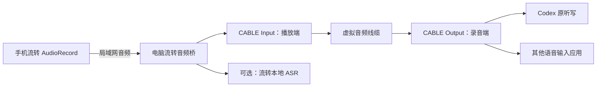

# 手机麦克风、Windows 听写与 Typeless 替代：调查与开发规划

调查日期：2026-10-16。状态：仅调查、规划，尚未实施。此次仅阅读官网、作者仓库、系统文档和现有源码，并新增本报告；没有修改应用代码、安装软件/驱动、启动录音、连接手机、测试设备、构建、提交或发布。

## 1. 结论与需求拆分

可以实现无实体麦克风的 Windows 电脑使用局域网手机麦克风；现成产品和公开源码均已有。用户随后明确“先看开源，不要重复造轮子”：当前推荐改为先组合现成工具，流转先不改。下文自研模块与分期仅保留为现成工具确有缺口时的后备分析，不是实施任务。

### 1.1 当前首选：直接复用，不先造音频协议或识别内核

| 实际目标 | 优先组合 | 当前是否需要改流转 |
|---|---|---|
| 电脑没麦克风，但用 Codex 原听写 | MicYou 或 AndroidMic → Windows 虚拟音频线缆 → Codex 原听写 | 从接口设计看不需要；设备选择和兼容性后续再验收 |
| Typeless 式中文输入与去口头语 | 同一虚拟麦克风 → Handy 或 OpenWhispr | 不需要先重写 ASR、热键、浮层、粘贴 |
| 电脑应用录音时自动推流 | 研究 VoxMic 已有录音会话监测；MicYou 已有静音控制可作为适配点 | 尚非简单配置即完整具备；仅缺口层评估适配 |
| 停止录音就释放手机麦克风 | 需要区别静音、停发与停止 AudioRecord | 不能把远程 mute 当现成功能等价物；Android 侧仍需核实/适配 |

这两条听写路线择一使用：Codex 原听写不需要 Handy 再转写一次。两个独立程序遵循系统音频接口组合，并不要求并入流转源码。Windows 侧虚拟线缆如 VB-CABLE 并非全栈开源，许可和安装单独处理。

进一步源码核实：MicYou 的[插件 API](https://github.com/MicYou-Dev/MicYou/blob/master/docs/plugins/api-reference.md)已有 `set_muted/get_muted`；[宿主设置实现](https://github.com/MicYou-Dev/MicYou/blob/master/tauri-app/crates/micyou-core/src/settings.rs)可向手机同步静音。[Android AudioEngine](https://github.com/MicYou-Dev/MicYou/blob/master/composeApp/src/main/kotlin/com/lanrhyme/micyou/audio/AudioEngine.kt)静音时仍读取 AudioRecord，只是不继续编码发送。因此后续可研究“Windows 录音会话监测 → 现有静音 API”的小插件，复用传输与 DSP；要真正停止采集/释放麦克风则另需 Android 适配。该插件是可行性推断，尚未开发。不能同时运行 MicYou 与 VoxMic 就宣称两者自动拼成完整按需方案。

VoxMic 的 [ADB 控制](https://github.com/melody0709/vox_mic/blob/main/src/adb_control.cpp)使用通用设备序列号和端口转发，未强制只选 USB。因此无线调试配对后通过无线 ADB 复用传输有代码依据，但仅为推断，未实测，也不等于官方提供普通局域网直连。MicYou [插件例外许可](https://github.com/MicYou-Dev/MicYou/blob/master/LICENSE)对独立非商业/商业插件另有条件，后续适配前核对，不默认为任意商用复用。

Handy 已发布版本含[麦克风选择器](https://github.com/cjpais/Handy/blob/v0.9.8/src/components/settings/MicrophoneSelector.tsx)、[后处理/热键/中文设置](https://github.com/cjpais/Handy/blob/v0.9.8/src-tauri/src/settings.rs)、[录音悬浮预览](https://github.com/cjpais/Handy/blob/v0.9.8/src/overlay/RecordingOverlay.tsx)。OpenWhispr 同样已有[输入设备选择](https://github.com/OpenWhispr/openwhispr/blob/v1.10.3/src/components/ui/MicrophoneSettings.tsx)和[听写清理/助手作用域](https://github.com/OpenWhispr/openwhispr/blob/v1.10.3/src/config/inferenceScopes.ts)。因此当前不规划重新实现这些现成功能；实时预览仍取决于所选模型和路径。

另有已经实现“手机识别、局域网发送文字、电脑光标输入”的 [Vox Manager](https://github.com/dklymentiev/voxmanager)（GPL-3.0，仓库标注 Pre-release）和使用手机输入法转写的 [TextDrop](https://github.com/alone-tree/TextDrop)。这类方案可以省去系统麦克风桥，但传的是文字，不能替代 Codex 原听写按钮的原始音频输入。Vox Manager 的识别依赖 Android 语音服务，不能把它描述成必然离线的自带模型方案。

不把“官网 GitHub 下载”自动认作开源：例如 Sayvoro 下载指向安装包发布仓库，本次未确认其完整应用源码与开源许可证，暂不列作可复用内核。

| 需求 | 实际要做的事 | 本次判断 |
|---|---|---|
| 手机替代电脑麦克风 | 手机采音、局域网传输、Windows 暴露录音设备 | 可行，已有产品和开源先例 |
| 点击 Codex 原听写按钮即使用手机声音 | Codex 选择该录音设备；流转观察设备使用状态并控制推流 | 有实现路径，当前 Codex 与目标手机兼容性待验收 |
| 手机完全退出/被杀后，电脑任意命令无提示开麦 | 从 Android 后台冷启动麦克风 | 不能作为首版承诺，受平台限制 |
| Typeless 式语音输入 | ASR 转写、可选文字清理/润色、光标输入 | 开源替代已有，可独立接入 |
| 取得 Typeless 完整 Windows 官方/逆向源码 | 公开且可复用的应用、识别及润色实现 | 本次未核实到，不能把传播视频当作已开源证据 |

这里“可行”表示文档、源码所支持的技术路线，不表示已在用户手机或电脑验证。麦克风功能本身可使用普通 Android 音频权限，不要求 Root 或 LSPosed；现有剪贴板 Hook 保持独立。

## 2. Typeless 开源情况与参考项目

### 官方、复刻和逆向需要分开判断

Typeless 提供 [Windows 下载](https://www.typeless.com/downloads)。本次官网查阅未找到完整应用和模型开源声明；官方[隐私政策](https://www.typeless.com/privacy)明确其音频和有限上下文在云端处理。因此复刻界面、增强原客户端快捷键，或封装服务请求，都不等于取得同样的本地识别与润色内核。

近期 REATypeless、Saydra 的传播线索尚未找到可确认的 Windows 公共源码；对应原帖本次无法读取，保留【待确认】。有源码的 [Roko Input](https://github.com/bassnova42/rokoinput) 为 macOS 项目，使用 Apple 系统能力，且自定义许可证限制个人非商用，不作为本项目 Windows 基础。

更适合参考的是独立实现：

| 项目与作者源 | Windows 与处理方式 | 借鉴内容及边界 |
|---|---|---|
| [Handy](https://github.com/cjpais/Handy) | 跨平台、本地识别，MIT 代码 | 快捷键、状态浮层、自动粘贴和模型管理。中文选择多语言模型，不默认把 Parakeet 任意型号视为支持中文；品牌素材另核许可 |
| [OpenWhispr](https://github.com/OpenWhispr/openwhispr) | Windows，本地或自备密钥云模型，MIT | ASR 与文字处理可切换、全局输入；启用云服务后不能称全离线 |
| [Typeless but Free](https://github.com/AgentGameLab/typeless-but-free) | Windows、本地 faster-whisper，可选 LLM 清理，MIT | 简单按住说话、中文设置、预览；项目较小，生产成熟度需后续评估 |

维护快照可见 [Handy v0.9.8](https://github.com/cjpais/Handy/releases/tag/v0.9.8)、[OpenWhispr v1.10.3](https://github.com/OpenWhispr/openwhispr/releases/tag/v1.10.3) 和 [Typeless but Free v0.1.0](https://github.com/AgentGameLab/typeless-but-free/releases/tag/v0.1.0)。这些项目不因此自动具备手机局域网麦克风或 Codex 按钮联动。

流转可保留现有 WPF/Kotlin，接可替换的识别引擎，不需要迁移为上述项目的整个应用框架。优先候选：[sherpa-onnx](https://github.com/k2-fsa/sherpa-onnx)（Apache-2.0，含 C#/Kotlin、中文模型示例）、[whisper.cpp](https://github.com/ggml-org/whisper.cpp)（MIT、多语言 Whisper）。代码、模型权重、第三方依赖分别审查许可；中文效果和速度待真实语料评估。

## 3. 手机当 Windows 麦克风：谁已经做了

| 项目与主源 | 已公开能力 | 对流转的参考价值 |
|---|---|---|
| [AudioRelay](https://audiorelay.net/docs/windows/use-your-phone-as-a-mic-for-windows) | Android 麦克风经网络供 Windows Virtual Mic 使用 | 现成使用流程参考，不作为开源内核 |
| [WO Mic](https://www.wolicheng.com/womic/download.html) | 手机端、Windows 客户端及麦克风驱动 | 现成系统麦克风方案，不等于开源 |
| [MicYou](https://github.com/MicYou-Dev/MicYou) | Android + Windows，Wi-Fi/USB/Web；Windows 使用 VB-CABLE | 与局域网需求很接近；GPLv3 + Plugin Exception，不能按宽松许可随意抽取核心代码 |
| [AndroidMic](https://github.com/teamclouday/AndroidMic) | Android → Windows，Wi-Fi TCP/UDP、USB；通过外部虚拟线缆成为系统录音输入 | GPL-3.0；可与流转独立并存，不需流转重写采音/传输；未找到随 Codex 按钮自动启停手机采集的证据 |
| [VoxMic](https://github.com/melody0709/vox_mic) | Android → USB/ADB → VB-CABLE → Windows App，按录音端点使用状态控制音频链路 | 与“应用开始录音才推流”最接近的公开实现；主仓库 BSD-3-Clause，但它是 USB/ADB 路线，不能说已有现成流转局域网集成 |

VoxMic 的源码目标 SDK 为 34，不能据此担保本项目 Android 16/API36 的行为。其延迟和功耗数字为作者报告，本次未实测，不作为产品性能承诺。主仓库许可证也不替代其第三方依赖审查。

当前建议优先直接使用 MicYou/AndroidMic 的完整程序；只有出现实际缺口时，再参考 VoxMic 的会话监测做小范围适配。无需先在流转架构内独立重写。当前不安装、不修改现有环境。

## 4. Codex 原听写按钮如何接入

### 走 Windows 录音设备层

虽然叫 Input/Output，方向不能写反：流转向 CABLE Input 播放音频，应用从 CABLE Output 录音。[VB-CABLE 官方定义](https://vb-audio.com/Cable/)。不能把原始声音仅播放到电脑扬声器，也不能把系统全部播放声音误导入麦克风。

OpenAI 官方说明：[Dictate 会把语音转成编辑器文字，用户可以检查再发送](https://learn.chatgpt.com/docs/prompting#use-voice-dictation)。本次查阅没有找到向第三方公开的“听写按钮按下/松开事件”或远程麦克风启动接口；因此不以内部 Hook、改 Codex 程序、识别按钮坐标作为基础。

本机只读识别到 Codex 包版本为 26.1013.3656.0，没有操作其设置或启动听写。本方案推断 Codex 可像其他 Windows 应用一样使用虚拟录音端点，但是否使用系统默认设备、是否提供应用内设备选择，以及是否预先保持音频流，均需后续验收，当前不宣称已兼容。

Codex 原听写路线中，流转只供声音，识别由 Codex 负责；不需流转先识别再识别一次。局域网传音频不代表识别环节也离线，不能将整个 Codex/Typeless 链路宣传成纯离线。

### 自动联动观察的是音频会话，不是按钮本身

Windows 侧可观察指定录音端点的会话创建与 Active/Inactive 状态。会话开始运行后通知手机推流，最后一个符合条件的使用者退出后延迟短时间停传。Active 的定义以 [AudioSessionState](https://learn.microsoft.com/en-us/windows/win32/api/audiosessiontypes/ne-audiosessiontypes-audiosessionstate) 为准，而非根据音量大小推断。

以下必须保留回退：

- 只监听选定录音端点；桥自身向播放端写入不算录音使用者。自己的录音测试、系统声音设置预览等要避免误触发。
- 软件可能预开并保持麦克风，状态变化不总与 UI 按钮一致。
- [GetProcessId](https://learn.microsoft.com/en-us/windows/win32/api/audiopolicy/nf-audiopolicy-iaudiosessioncontrol2-getprocessid) 对跨进程音频会话有边界，不能保证精确对应 Codex UI 进程。应用允许列表需要验证，识别不明时不自动开麦。
- 提供“麦克风已就绪”提示；初次手机采音存在准备延迟，外部应用不会必然等待，不能先承诺第一字绝不丢。
- 首版保留手机手动开关和电脑快捷键。自动联动是后续增强，不影响手动路线。

## 5. Android 16：可交付边界

项目 minSdk/target 为 36。新增采集需要 RECORD_AUDIO、FOREGROUND_SERVICE_MICROPHONE、microphone 服务类型和可见通知；现有 connectedDevice 前台服务不能自动获得麦克风后台启动资格。[服务类型说明](https://developer.android.com/develop/background-work/services/fgs/service-types#microphone)。

普通后台收到 WebSocket 命令不等于满足麦克风前台服务启动条件。[官方后台启动限制](https://developer.android.com/develop/background-work/services/fgs/restrictions-bg-start)。可靠基线规划为：

1. 用户先在手机可见界面开启限时麦克风会话并授权，合法启动采集和麦克风前台服务。
2. 电脑可以在该会话内控制是否推送声音；手机持续显示正在采音/正在发送的区别，以及目标电脑和停止按钮。
3. 未准备好时，电脑显示“请在手机开启麦克风”，可发通知让用户点按，不能显示假录音状态。
4. 会话关闭、断网、撤权、电脑结束会话时释放采集资源；后续重新连接不悄悄恢复敏感录音。

“先只创建服务但不启动 AudioRecord，之后锁屏再首次开采”作为省电探索项，官方资料不足以担保跨 ROM 成功。应用被杀、手机重启或服务不存在时无提示远程冷启动，不纳入首版承诺。

停止推流与停止采音并非同一件事。可靠基线若持续采音以等待电脑使用，会有麦克风功耗与系统隐私指示；不能宣传待机零功耗。应有会话时限、随时停止、屏幕/通知状态和后续耗电对照。

## 6. 后备分析：确需整合时的流转代码边界

以下为现状依据，不表示已修改：

| 位置 | 当前状态 | 后续触点 |
|---|---|---|
| `Liuzhuan/Utils/FileClassifier.cs:21` | 音频只是文件分类 | 实时音频不进入素材上传流程 |
| `Liuzhuan/Liuzhuan.csproj:21` | 无 WASAPI/音频桥依赖 | 独立音频模块，可评估 NAudio/原生 COM |
| `Liuzhuan/Services/Lan/WsHub.cs:59,164` | 文本 WS；welcome 有 features | 双向能力与音频控制协商，旧端继续可用 |
| `AndroidApp/app/src/main/java/com/liuzhuan/app/net/LanClient.kt:322` | 消费现有回执能力 | 音频控制转交独立会话管理器 |
| `AndroidApp/app/src/main/AndroidManifest.xml:4,77` | 无录音权限，FGS 仅 connectedDevice | 新麦克风服务与运行期权限；不改原服务停启规则 |
| `Liuzhuan/Services/HotkeyService.cs:35` | 单热键注册会替换原热键 | 扩为多个独立热键 ID，保留素材栏快捷键 |
| `Liuzhuan/MainWindow.xaml.cs:940` | 复制到剪贴板，提示手动粘贴 | 自有听写阶段才增加有边界的文本注入 |

建议新模块：Android `audio/MicrophoneService`、`AudioCaptureController`、`AudioSessionState`、会话设置页；PC `AudioSessionCoordinator`、`AudioTransport`、`AudioJitterBuffer`、`VirtualMicrophoneBridge`，后期再加 `SpeechEngineHost` 和 `DictationTextPipeline`。以上模块本次均未创建。

协议方向：

- 双向协商 `audio_capture_v1` 与编码格式；控制包含 requestId、streamId、目标、期限、ready/started/stopped/error，不沿用素材 ID 冒充音频会话。
- 音频使用独立连接及有界队列，帧含序号、单调时钟、格式与采样数。实时流拥塞时丢弃过时音频/明确中断，不能无限缓存后在重连时回放旧声音。
- 可先用 16 kHz、单声道、16 bit PCM，原始数据约 32 KB/s、1.92 MB/分钟；这是数学估算，不是测速。后续评估 Opus，Windows 桥按录音端点要求重采样。
- 独立音频连接不重复同名 hello：现有服务器会替换同名设备会话，否则可能踢掉剪贴板连接。使用与控制会话绑定的短期票据及独立流角色。
- 音频只发给明确批准的电脑，不进入 DataStore，也不广播到其他已连接手机。原复制/回执/快照优先级不被音频挤占。
- 当前 WS/HTTP 是明文 LAN 协议，不能称音频加密。首版应设计扫码固定证书指纹/可信设备确认与加密音频连接；不能仅有票据就声称获得加密或额外开麦授权。

## 7. 后备研发顺序与退出条件（现成工具不足时再评估）

当前动作是调查现成组件，优先复用第 1.1 节的组合；下表不是当前开工安排，不应跳过复用评估直接开发。

| 阶段 | 工作范围 | 完成后用户得到什么 | 后续验收门槛 |
|---|---|---|---|
| P0 技术可行性验证，未执行 | 确认驱动端点、Codex 设备选择与手机后台会话策略 | 决定可承诺的交互与省电边界 | 正常采音、停止释放、就绪延迟、当前 Codex 实际选定端点 |
| P1 通用手机麦克风 | Android 明确开启会话；LAN 音频；PC 桥接现成签名虚拟线缆；手动控制 | 无实体麦克风的电脑能从手机收音，并使用 Codex 原听写 | 普通 Wi-Fi/手机热点、断线停止、旧剪贴板链路不回归 |
| P2 应用自动联动 | 录音端点会话监测、允许列表、最后使用者退出防抖、手动回退 | 手机已开启会话时，电脑应用使用麦克风即可推流 | Codex 预开流/多进程、系统预览误触发、首字、锁屏与来电 |
| P3 流转自有听写 | PC 本地 ASR、原文预览、复制，再加安全粘贴与可选润色 | 任何普通输入框可用流转快捷键输入，不限 Codex | 中文/中英混说、专名数字、光标/焦点变化、密码框、原意保持 |
| P4 后续专项 | 真正按需冷采音、Opus/降噪优化、可能的自有签名驱动 | 更低功耗、更少安装步骤 | 有数据支持再承诺，不能合并为 P1 必达项 |

上述顺序优先覆盖用户最关心的 Codex 原按钮；P3 也可单独提早，但那是流转自有听写，不能用它替代 Codex 原按钮需求。工期应在 P0 后依据实际 ROM、驱动端点与 ASR 硬件选型确定，本报告不提供未经验证的固定交付日期。

驱动首版建议用户从官方安装 VB-CABLE，流转检测并引导选择设备。它不是流转内部普通 DLL，首次驱动安装涉及管理员操作；不在本次执行。[VB-Audio 分发规则](https://vb-audio.com/Services/licensing.htm)需按具体基本包、企业及其他 Cable 产品分别遵守，不自行改名隐藏来源。自研驱动可研究 [Microsoft 音频驱动样例](https://learn.microsoft.com/en-us/windows-hardware/drivers/audio/sample-audio-drivers)，但 WDK、签名、内核稳定性与兼容维护独立立项。

P3 的文字模式建议为“逐字 / 清理口头语 / 润色”，默认保持原意，专名词典可维护。ASR 在 PC 独立进程按需加载，手机不跑大模型，避免影响素材栏与剪贴板服务。润色失败保留原文，不自动发送消息；粘贴前检查目标窗口与焦点，失败回退复制，保护密码框并处理管理员窗口限制。选用云识别/润色时单独展示数据去向与凭据/计费要求，本次不调用服务或购买资源。

## 8. 决策与未确认项

当前推荐“独立 MicYou/AndroidMic + 合规虚拟线缆 + Codex 原听写或 Handy/OpenWhispr”，先不修改流转。只对现成工具没有覆盖的自动启停、授权和状态联动层评估适配，不重造音频驱动、传输、ASR、热键和浮层；不把逆向 Typeless 私有服务或修改 Codex 当作开发前提。

待后续获准实施时验证：当前 Codex 麦克风选择及保持流行为；目标 Android 16/ColorOS 的会话内锁屏、停止/重启采集；电脑硬件和中文 ASR 模型；驱动路由与睡眠唤醒；音频加密与旧协议兼容；真实待命耗电、首字延迟及大文件并发。现在没有任何一项被写作实机已通过。

本次不修改版本号、不生成 APK/EXE、不改变系统默认麦克风、不继续数据版、不执行 Git 提交/推送或 Releases 操作。
